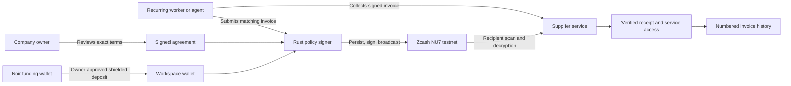

<p align="center">
  
</p>

<p align="center">
  Private recurring payments. Clear agreements. Verifiable invoices.
</p>

<p align="center">
  <a href="#try-tandem">Try Tandem</a> |
  <a href="#how-it-works">How it works</a> |
  <a href="#for-agents">For agents</a> |
  <a href="#run-locally">Run locally</a> |
  <a href="docs/workspaces.md">Operations</a>
</p>

Tandem lets a business authorize a recurring supplier relationship and delegate its routine payments. A Rust signer checks the agreed recipient, amount, schedule, expiry and spending caps before signing a shielded Zcash payment. The supplier issues a signed invoice and independently verifies receipt before granting service access.

The application brings service discovery, agreement review, Noir funding and billing records into one workspace. Payment details stay shielded on-chain; the authorized parties retain the records needed to understand each charge.

**Release:** Zcash NU7 testnet only. The app uses service-managed operating wallets and approval keys. This is not a mainnet custody service.

## Try Tandem

A public deployment has not been configured yet. The local application runs at **http://localhost:4176** after setup below. There is no production URL to advertise.

| Entry point | What you can do |
| --- | --- |
| `/` | Understand the product and open the application |
| `/services` | Browse the curated connected service |
| `/services/network-telemetry` | Read price, delivery, cadence and operator details |
| `/app` | Sign in and see the next step for your workspace |
| `/app/agreements` | Review exact terms, authorize, inspect or cancel |
| `/app/wallet` | Fund your own workspace through Noir |
| `/app/invoices` | Read signed invoices, verified receipts and paid service access |
| `/agents` | Understand the agent workflow and API |

### Review without installing a wallet

The login page prefills `judge` / `tandem-review` when the operator has enabled a recorded evidence pack. These are intentionally public review credentials. They open genuine saved testnet agreement, invoice and receipt records, with historical observations clearly identified.

Review access cannot authorize payments, send funds, cancel agreements or change wallet state. To execute a new payment, choose **Create a private workspace** and use your own account and testnet funds. The review account is not provisioned automatically without an evidence pack; see [review access setup](docs/workspaces.md#recorded-review-access).

## The company journey

1. **Find a supplier.** Read the service, operator, price and delivered resource in the directory.
2. **Create a private workspace.** Each account gets independent wallet, agreement and invoice state.
3. **Fund with Noir.** Approve a 0.05 TAZ shielded transfer to your workspace. Funding does not authorize a subscription.
4. **Review exact terms.** Choose the schedule and payment count. Inspect the supplier identity, recipient, per-period amount, fee allowance, total cap and expiry.
5. **Authorize the agreement.** The worker can now collect matching invoices and execute payments without an open browser.
6. **Follow settlement.** A transaction ID is a submission. A paid invoice requires the supplier's independent receipt verification.
7. **Use the service or stop renewals.** Open the paid resource from its invoice. Cancellation stops future signing while preserving billing history.

### Available service

**Network Telemetry**, operated by Tandem, provides Zcash testnet chain height, consensus branch and latest block time. Each paid service period costs **0.01 TAZ**, with at most **0.001 TAZ** network fee per payment. Choose one to three payments, every ten minutes, hour or day. The maximum allowance for three payments is **0.033 TAZ**, including fees.

This is the first connected reference supplier, not a marketplace of independent companies. Additional services will be listed after their payment and receipt integrations are verified. Self-service supplier publishing is not implemented.

## How it works



- **Terms are bound to signatures.** Canonical Ed25519 agreement signatures cover the exact authority. Supplier signatures bind each period's payment request and billing document.
- **The signer constructs the transaction.** Agents cannot submit an arbitrary recipient, amount or PCZT for signing. Actual outputs are checked against the approved payment and owned change.
- **Retries preserve identity.** A durable SQLite occurrence ledger reserves the billing period and allowance. Signed artifacts and exact raw bytes are retained before broadcast. Ambiguous signing requires recovery, not a replacement payment.
- **Revocation has a signing boundary.** The signer rechecks authority at final signing. Already authorized transactions can still settle after cancellation.
- **Receipt verification is separate.** The supplier scans and decrypts its own received payment, checks the exact amount and memo, and requires confirmations. Paid service expires at the original period boundary.
- **Billing remains auditable.** Stable invoice numbers, signed line items, service periods, payment states and receipts are available as CSV, JSON and native PDF. Tax invoicing, fiat conversion, proration and refunds are outside this release.

## For agents

The public site serves useful discovery information without requiring JavaScript:

| Resource | Purpose |
| --- | --- |
| `/llms.txt` | Product context, full workflow and authority boundaries |
| `/agents.md` | Markdown version of the agent guide |
| `/.well-known/tandem.json` | Project-specific discovery document, links and access modes |
| `/openapi.json` | OpenAPI 3.1.1 contract for the account application |
| `/api/catalog` | Service identifiers, exact prices, schedules and setup links |

Start with the catalog, authenticate, propose exact terms, obtain owner authorization, then observe existing payment and invoice records. A `202` response means a queued operation; poll `/api/workspace` for completion. Reviewer sessions are read-only. Public documentation does not grant spending authority.

The repository also includes **eight stdio MCP tools** for the separately deployed Unix signer/supplier services. This is distinct from the account application's HTTP API and needs operator-configured execution capabilities. There is no public remote MCP endpoint. The built-in renewal worker is deterministic and requires no AI model.

See [account operations and trust](docs/workspaces.md) and [lower-level HTTP/MCP integration](docs/backend-api.md).

## Stack

| Layer | Technologies |
| --- | --- |
| Shielded wallet and signer | Rust, official librustzcash crates, PCZT, Orchard/Ironwood |
| Chain access | NU7 testnet through hosted lightwalletd at testnet.zec.rocks |
| Authorization | Ed25519, canonical JSON, signed agreements/invoices/revocations |
| Persistence | SQLite, durable occurrence ledger and filesystem outbox |
| Account application | Node.js 22, salted scrypt passwords, HttpOnly session cookies |
| Interface | React 19, TypeScript, Vite, local DM Sans and Instrument Serif fonts |
| Funding | Official `@noir-wallet/sdk` and a NU7-compatible Noir testnet extension |
| Agent integration | Documented HTTP API, OpenAPI, Markdown discovery, MCP SDK |
| Runtime | Linux, Docker Compose, persistent private storage, HTTPS reverse proxy |

Pinned Zcash cohort: `zcash_client_backend` 0.25.0, `zcash_client_sqlite` 0.23.0, `zcash_protocol` 0.11.0, `zcash_primitives` 0.31.0, `zcash_keys` 0.17.0, `pczt` 0.10.0 and `orchard` 0.16.0. Network operations explicitly require NU7 and reject mainnet, pre-NU7 heights and branch mismatches. [Dependency attribution](THIRD-PARTY.md).

## Run locally

Requires Linux, Rust 1.96 or compatible, Node 22.13 or later in the Node 22 line, npm, CMake and a C compiler. Node's SQLite API is experimental in this runtime. Keep all wallet state outside the repository.

```sh
npm ci --prefix web
npm run build:product --prefix web
cargo build --locked --bins

export APP_STATE_DIR="$HOME/.local/share/tandem-private-workspaces"
export PRP_BINARY="$(pwd)/target/debug/private-recurring-wallet"
export APP_ORIGIN=http://localhost:4176
mkdir -p "$APP_STATE_DIR"
chmod 700 "$APP_STATE_DIR"

docker compose -p tandem-product -f deploy/product.compose.yaml up -d --build
```

Open **http://localhost:4176** in the browser containing Noir. Use the testnet extension; mainnet and testnet builds can compete for the same injected provider. The recorded funding integration used Noir's official [NU7 PR53 preview](https://github.com/NoirWallet/noir-wallet/pull/53), not a stable NU7 release. Verify the build you install against the current vendor documentation.

Without Docker, start `flock -n "$APP_STATE_DIR/application.lock" node app/server.mjs` with the same environment. Run one application process per state directory. Existing state is never replaced by startup.

For public testing, configure the exact HTTPS `APP_ORIGIN`, a domain and TLS proxy, and persistent storage. The app binds to loopback; `deploy/Caddyfile.product` is the proxy sample. Cookie security derives from the configured HTTPS origin. See [deployment, backups and review access](docs/workspaces.md).

## Trust boundaries and current limits

Tandem's account release holds operating-wallet seeds and both agreement approval keys. Two signatures validate the policy format; they are not two independently administered human approvals. The operator can access hosted records and funds. Account isolation protects users from other normal accounts, not from the operator.

Seeds and business records are not encrypted at rest. Noir retains the funding wallet's keys, while the hosted lightwallet endpoint can observe network requests. Nym/Tor transport is not integrated. An external AI provider sees any records supplied to it.

The current app supports one fixed-service agreement per workspace, including after expiry or cancellation. Password reset, MFA, independent supplier onboarding, full rollback protection and production custody are not implemented. Chain reorganization and incomplete observations can invalidate a cached receipt. Mainnet is disabled.

The isolated lower-level signer deployment has different process and key boundaries from the account gateway. Do not apply its isolation claims to the unified application. [Account architecture](docs/workspaces.md) | [Signer guide](docs/agreements.md) | [Billing records](docs/billing.md).

## Verification

```sh
bash scripts/check-backend.sh
npm test --prefix web
npm run build:product --prefix web
```

Tests cover signed authority, actual payment outputs, duplicate periods, durable recovery, revocation, signed billing, account isolation, public reviewer restrictions, API discovery and metadata. A build or an empty workspace is not evidence of live settlement.

Real recurring NU7 testnet payments were independently verified by the supplier, including:

- [`dfb9ec9f...92333a9d`](https://testnet.zcashexplorer.app/transactions/dfb9ec9f9f1aa5922d1dd7dfeeff26bed73f424072eb0698bf7345df92333a9d), mined at 4,581,578.
- [`083d7cc2...90031358`](https://testnet.zcashexplorer.app/transactions/083d7cc22f237f9073122da1758e44620200c0c1fd1ee170ccdef32990031358), mined at 4,581,601.

Both supplier receipts record NU7 branch `77190ad9` and 0.01 TAZ received. These are lower-level recurring-service evidence; the fresh account application's funded lifecycle remains a separate release check. The read-only review workspace preserves these records without presenting them as new activity.

## Repository map

- `src/`: wallet, policy enforcement, occurrence ledger, supplier and billing modules.
- `app/`: account gateway, background jobs, read-only review and public discovery.
- `shared/`: curated service contract and intentionally public review credentials.
- `web/`: landing, overview, service directory, agent guide, agreements, funding and billing.
- `agent/`: recurring worker and stdio MCP adapter for the lower-level deployment.
- `deploy/`: container and reverse-proxy configuration.
- `docs/`: user, operator and architecture documentation.

The social preview uses the approved Sealed artwork; favicon and logo assets are under `web/landing/public`. Private keys, live wallet databases and review evidence packs belong outside this repository.
